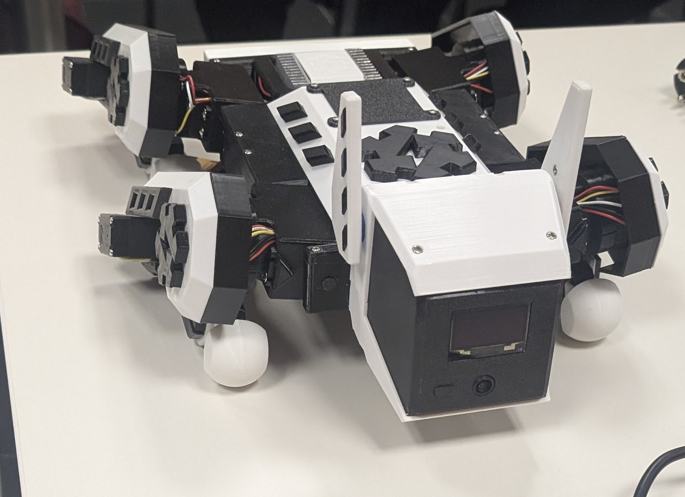

# robot-dog

A quadruped robot built at EspaiTec — Universitat Jaume I (Castelló de la Plana).

## Current state

The first leg is under firmware control, commanded live from a serial console.
The rest of the frame is still being built.

## The leg

A closed-chain four-bar mechanism with three driven axes:

| Axis | Motion |
| --- | --- |
| `ABD` | abduction — swings the whole leg sideways |
| `FEM` | femur — raises and lowers the knee |
| `MAN` | ankle — not a direct joint: driven through a crank-and-rod linkage |

## Firmware (`main.ino`)

- The ESP32 drives FEETECH STS serial-bus servos on `Serial2` at 1 Mbaud (RX 16 / TX 17).
- `enviarServos()` writes all three setpoints in a single `SyncWritePosEx`, so the axes
  move together instead of chasing each other.
- `calcularIK()` solves the leg analytically:
  - abduction from `atan2` in the body frame;
  - femur and tibia from the law of cosines, rejected when the target falls outside
    `|Lf − Lt| < d < Lf + Lt`;
  - ankle angle from the crank-and-rod quadrilateral.
- `moverPie()` refuses targets that are out of reach or past the servo travel
  (`1024 … 3072`), rather than sending a move that would bind the mechanism.
- The serial console takes `x y z` in millimetres, plus `r` (rest pose), `m` (mounting
  pose) and `p` (read back the current positions).

Link lengths, gear sense and mounting offsets are constants at the top of the file.

## Next

- Drive the remaining legs with the same solver.
- Close the loop on the kinematics: forward-solve the commanded angles and compare
  against the point that was asked for.
- Gait generation on top of that.
